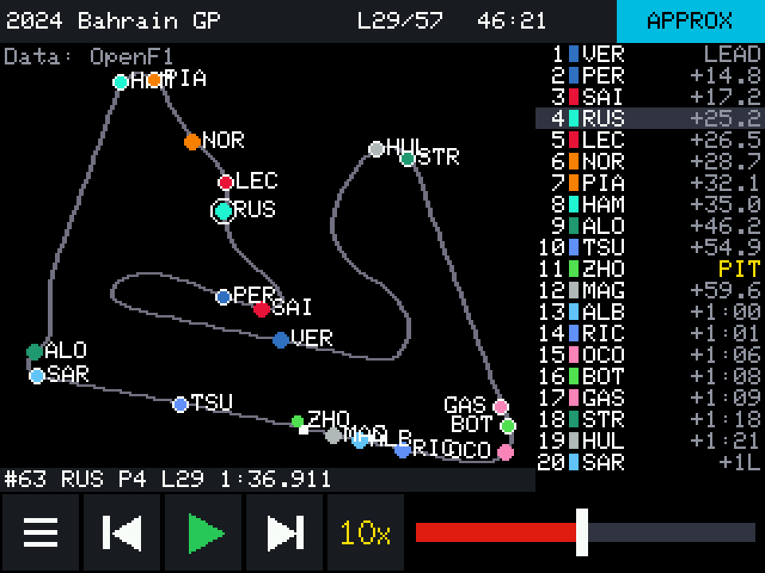
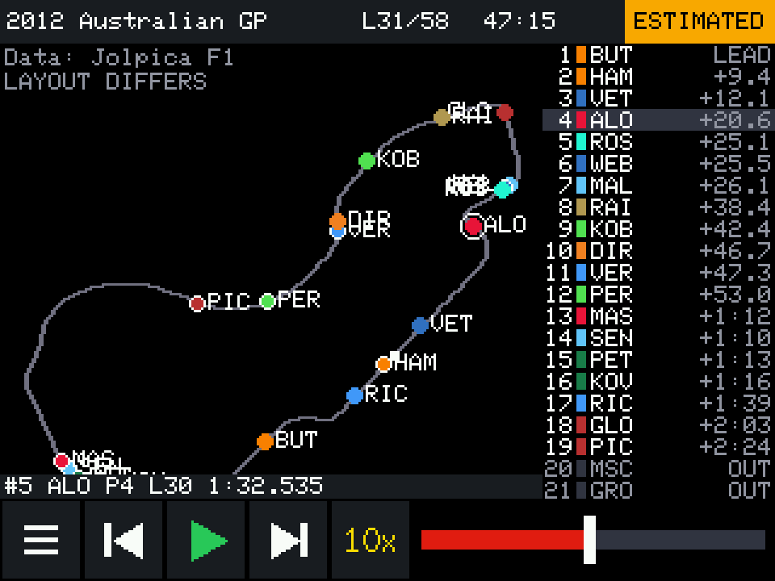

# F1 Race Replay Display

Replay real Formula 1 races on an ESP32 "Cheap Yellow Display". Colored dots move
around the real circuit while the screen shows the lap, the race clock and the
running order. You pick the season and race on the touchscreen, then play, pause,
change speed and scrub through the race.

This is a timing and position display, not video.





*Screens drawn on a PC by the firmware's real UI code, using real race data. These are
not photos of the board.*

There are two parts:

| Folder | What it is |
|---|---|
| `data_tool/` | Python tool for your PC. Downloads real race data and converts it. |
| `firmware/F1ReplayCYD/` | Arduino sketch for the board. Plays the converted races. |

## How accurate are the dots?

The label at the top right of the replay tells you what you are looking at.

| Label | Seasons | Where the dots come from |
|---|---|---|
| **APPROX** | 2023 onward | Real car location samples from OpenF1, about 3.7 per second. Good for where a car is around the lap, but not its exact line on the track. |
| **ESTIMATED** | 1996 to 2022 | **Not location data.** Real lap times from Jolpica place each car at the timing line. Between crossings its position is modeled. |
| None | Before 1996 | No replay. Only race results exist, and the tool will not invent lap times. |

For **ESTIMATED** races:

- Lap times, pit stops, retirements and finishing order are real where the source has them.
- Jolpica has no sector times, so movement inside a lap follows a speed profile taken
  from a modern lap of that circuit. If there is no profile, it uses a constant speed.
- `SLOW*` means most of the field slowed on those laps. It is inferred from the
  timing: no race-control data exists for these races, so it could be a safety car, a
  red flag or weather.
- Pit stops before 2011 appear only as slower laps, because no pit data exists.
- A retired car disappears at its last recorded lap. Where it really stopped is unknown.
- When the source is missing a lap time, the tool first tries to recover it exactly from
  the car's official race time. If it can't, and the car must stay on track, it uses the
  field's median for that lap and says so in the notes. A retired car's untimed final laps
  are never invented, and lap records listed after a car retired are ignored as source errors.

Tap the label during a replay to read the notes for that race. Any missing or filled-in
data is listed there and in `data_tool/out/f1replay/reports/`.

## What you need

- ESP32-2432S028 board with a **data** USB cable. Many cables only carry power.
- A microSD card, **32 GB or smaller, formatted FAT32**. Each race is 2 to 3 MB.
- Windows 11, [Python 3.10 or newer](https://www.python.org/downloads/), and
  [Arduino IDE 2](https://www.arduino.cc/en/software).
- **About 10 GB of free disk space** for the ESP32 board package. It unpacks compilers
  for many chips, and the install fails partway through if the disk fills up.
- A stylus or fingernail works best, because the touchscreen is resistive.

No API keys or paid accounts are needed.

## Step 1: Set up the data tool

Open **PowerShell** in this project folder. In File Explorer, Shift + right-click the
folder and choose *Open in Terminal*. Then run:

```powershell
python -m venv .venv
.venv\Scripts\python -m pip install -r data_tool\requirements.txt
```

If `python` is not found, reinstall Python and tick *Add python.exe to PATH*.

## Step 2: Download a real race

See which seasons and races are available:

```powershell
.venv\Scripts\python data_tool\f1tool.py seasons
.venv\Scripts\python data_tool\f1tool.py list --season 2024
```

Build a race from its round number:

```powershell
.venv\Scripts\python data_tool\f1tool.py build --season 2024 --round 1
```

A telemetry race takes about a minute, because the tool stays under OpenF1's free
limit of 30 requests per minute. Everything is cached in `data_tool\cache`, so a rebuild
needs no downloads.

Races from 1996 to 2022 come from Jolpica's database download: one 15 MB file, refreshed
monthly, instead of about 15 requests per race. That takes a whole run of 2002 to 2022
from about 10 hours to a few minutes. Races from 2023 on still take about a minute each.
Every race from 2002 to now is roughly 1.2 GB.

Other useful commands:

```powershell
# Build whole seasons. --missing-only skips races already built, so an interrupted
# run can be started again and carries on.
.venv\Scripts\python data_tool\f1tool.py build --season 2002-2022 --all --missing-only

# List whole seasons on the device, including races you have not built.
.venv\Scripts\python data_tool\f1tool.py catalog --seasons 2021-2024

# Check all built files.
.venv\Scripts\python data_tool\f1tool.py verify

# Or use the simple menu.
.venv\Scripts\python data_tool\f1tool.py
```

## Step 3: Copy races to the microSD card

Put the card in your PC and note its drive letter, then run this with your letter:

```powershell
.venv\Scripts\python data_tool\f1tool.py deploy --drive E:
```

This checks the files and copies only what changed. It never deletes anything on the
card. To copy by hand, put the `data_tool\out\f1replay` folder at the top level of the
card, so that you have `E:\f1replay\manifest.txt`.

Eject the card safely, then insert it into the slot on the board with the power off.

## Step 4: Install the Arduino software

1. Open Arduino IDE. Go to **Tools > Board > Boards Manager**, search for `esp32` and
   install **esp32 by Espressif Systems**. Version 3.3.12 was used to build this project.
2. Go to **Tools > Manage Libraries**, search for `LovyanGFX` and install it. Version
   1.3.0 was used. If it asks about dependencies, choose *Install all*.

No library files need editing, unlike many guides for this board. The display is set up
in the sketch.

## Step 5: Upload the firmware

1. Connect the board by USB.
2. Open `firmware\F1ReplayCYD\F1ReplayCYD.ino` in Arduino IDE.
3. In the **Tools** menu, set:

   | Setting | Value |
   |---|---|
   | Board | **ESP32 Dev Module** |
   | Port | The new COM port that appeared |
   | Partition Scheme | Default 4MB with spiffs |
   | Upload Speed | 921600. Use 115200 if uploads fail. |

4. Click **Upload** (the arrow) and wait for *Done uploading*.

No COM port? Install the
[CH340 driver](https://learn.sparkfun.com/tutorials/how-to-install-ch340-drivers/all)
and try another cable.

## Step 6: First start

1. **Touch calibration:** press and hold each yellow cross with a stylus, then tap
   **Accept**.
2. **Display setup:** check that each color bar matches its label and that the
   background is black. If not, see [Display problems](#display-problems). Tap **Done**.
3. Choose a season, then a race, then tap **Replay**.

These settings are saved. You can change them later under **Setup** on the season screen.

## Using the replay

The controls along the bottom hide after 4 seconds of playback, so the map and the running
order fill the screen. **Tap the map, or the top bar, to bring them back.** They stay up
while paused.

When a race ends, a 10-second countdown names the next race on the card, then plays it at
the same speed. Tap during the countdown to stay on the finished race. After the newest
race it continues from the oldest. Turn this off with **Setup > Auto-next**.

| Control | What it does |
|---|---|
| Menu (three lines) | Leave the replay |
| Skip buttons | Jump to the previous or next lap of the leader |
| Play / pause | Start or stop the replay |
| `2x` | Cycle the speed: 1x, 2x, 5x, 10x, 30x, 60x |
| Slider | Tap or drag to move through the race |
| Running order | Tap a driver to follow them and see their last lap time. Tap again to clear. |
| `more v` | Shows the rest of the order when more than 24 cars are listed |
| Track map | Show the controls. While they are showing, cycle the name labels: top 5, all, none |
| Top bar | Show or hide the controls |
| APPROX / ESTIMATED label | Open the notes for this race |

Reading the screen:

- The two cars of a team share a color. The second car has a white ring.
- A hollow gray dot means the source has no location for that moment, so it holds the
  last known position.
- A smaller dot is a car in the pit lane or one that has finished.
- The track turns yellow under a safety car or VSC, and red under a red flag.
- `PIT`, `OUT` and `FIN` replace the gap in the running order. `+1L` means one lap down.
- `LAYOUT DIFFERS` means the race used an older layout than the outline shown.
- When you follow a driver, a lap time starting with `~` was missing from the source and is
  estimated.

## Optional: Get races over Wi-Fi

This saves moving the card each time you build a race. The PC still does the conversion,
because a race is about 60 MB of raw data and the ESP32 cannot process that. The board
then copies the finished files from your PC.

```powershell
# Once: enter your Wi-Fi details, then run the deploy command from Step 3.
.venv\Scripts\python data_tool\f1tool.py wifi

# Each time: leave this running while you sync.
.venv\Scripts\python data_tool\f1tool.py serve
```

Then tap **Sync** on the season screen. The ESP32 needs a **2.4 GHz** network, and your PC
must be on the same one. If your PC's address changes, run `wifi` again.

Your Wi-Fi password is stored as plain text in `wifi.txt` on the card. The `serve` command
shares only the race files, without a password, so use it on a network you trust.

## Troubleshooting

### Upload problems

- **`Failed to connect` or `Wrong boot mode`:** hold the **BOOT** button when the IDE
  prints `Connecting...`, and release it when writing starts. Also try Upload Speed 115200.
- **Two USB ports on your board:** the USB-C port may not work with a USB-C to USB-C
  cable. Use a USB-A to USB-C cable, or the micro USB port.

### Display problems

Boards sold as ESP32-2432S028 come with different screen controllers, so these settings
are chosen on the device.

- **Colors look like a photo negative:** tap **Next panel**.
- **Red and blue are swapped:** tap **Swap red/blue**.
- **The image is upside down or mirrored:** tap **Rotate** or **Mirror**, then calibrate
  touch again.
- **The screen stays dark right after an upload:** press **RESET** (it may be labeled EN) once.
- **The screen is unreadable, so you cannot tap anything:** in Arduino IDE, set **Tools >
  Erase All Flash Before Sketch Upload** to *Enabled* and upload again. This clears the saved
  display and touch settings, so setup starts over. Set it back to *Disabled* afterward.
- **The screen is black:** check the USB cable and power source. Do not connect anything
  to pin 21 on the P3 connector, because it drives the backlight.
- **Flicker:** try another USB cable or power supply.

### Touch problems

- **Taps land in the wrong place:** go to **Setup > Calibrate touch**.
- **Taps do nothing at all:** the calibration may be wrong. Open **Tools > Erase All Flash
  Before Sketch Upload**, set it to *Enabled*, and upload again. This clears all saved
  settings. Set it back to *Disabled* afterward.
- **Finger taps are unreliable:** use a stylus or fingernail. The screen needs pressure.

### microSD problems

- **`No microSD card`:** power off, reseat the card, and press Retry. Use a card of 32 GB
  or smaller formatted as **FAT32**. Larger cards usually arrive as exFAT, which does not work.
- **`No race files`:** the folder must be at the top of the card: `E:\f1replay\manifest.txt`.
- **`Bad race file`:** run `verify`, then `deploy` again. If it mentions the format version,
  use the data tool and firmware from the same copy of this project.
- **A race says `NOT ON CARD`:** it is in the catalog but has not been built. Build it,
  then deploy or sync.

### Wi-Fi problems

- **`No Wi-Fi settings`:** run the `wifi` command, then copy files to the card.
- **`No Wi-Fi`:** check the network name and password. 5 GHz networks do not work.
- **`PC not reachable`:** keep `serve` running. Check that `server=` in `wifi.txt` matches
  the address `serve` prints. When Windows Firewall asks, allow Python on **Private**
  networks. Guest Wi-Fi often blocks devices from reaching each other.

### Data download problems

- **`UNAVAILABLE`:** the tool is telling you the data does not exist, for example before
  1996. It stops rather than guess.
- **`refused access (HTTP 401)`:** OpenF1 locks data during a session. Try again about
  an hour after the session ends.
- **Pauses or `rate limited`:** this is normal. The tool waits and retries by itself.
- **`failed after 7 attempts`:** check your internet connection, or try later. Finished
  downloads stay cached, so a rerun carries on from where it stopped.

## Data sources and licenses

| Source | Used for | License |
|---|---|---|
| [OpenF1](https://openf1.org) | 2023 onward: location, laps, positions, race control | CC BY-NC-SA 4.0 |
| [Jolpica F1](https://github.com/jolpica/jolpica-f1) | Race list, results, lap times, pit stops | CC BY-NC-SA 4.0 |
| [bacinger/f1-circuits](https://github.com/bacinger/f1-circuits) | Outlines for circuits OpenF1 has not covered | MIT |

- Both main sources allow **non-commercial use only**. Race files you generate carry the
  same license, which is why this repository includes no race data and no sample files.
- Rate limits checked in November 2026: OpenF1's free tier allows 3 requests per second and
  30 per minute. Jolpica allows 4 per second and 500 per hour. The tool stays below both.
- Team colors for races before 2023 are display choices from this project, because Jolpica
  has no colors.

This is an unofficial project and is not associated with Formula 1, the FIA or Formula One
Management. F1 and FORMULA 1 are trademarks of Formula One Licensing B.V.

The code in this repository is under the [MIT License](LICENSE).

## Known limits

- Only the main Grand Prix is supported, not sprint races.
- Outlines for estimated races are mostly modern layouts. Known changes show
  `LAYOUT DIFFERS`, but the list of changes is not complete.
- Races at Valencia, Korea, India, Fuji and Jerez are not replayed, because no outline
  source covers those circuits. The catalog shows them as unavailable. To add one, add its
  GeoJSON outline to the lookup in `data_tool/f1data/circuits.py`.
- For circuits using the GeoJSON outlines, the start line position is approximate.
- Accents are removed from names on the device, because of its font. The full names are in
  the `reports` folder.

## For developers

- The file format is described in [docs/FORMAT.md](docs/FORMAT.md).
- Data tool tests: `.venv\Scripts\python -m unittest discover -s data_tool\tests`
- Firmware tests run on the PC, using real race files. They need
  `.venv\Scripts\python -m pip install ziglang pillow`, then:
  `.venv\Scripts\python tests\native\run_native_tests.py`
- Add `--ui --lovyangfx <LovyanGFX folder>` to run the real UI with scripted taps and save
  screenshots to `tests\native\build\screens`.
